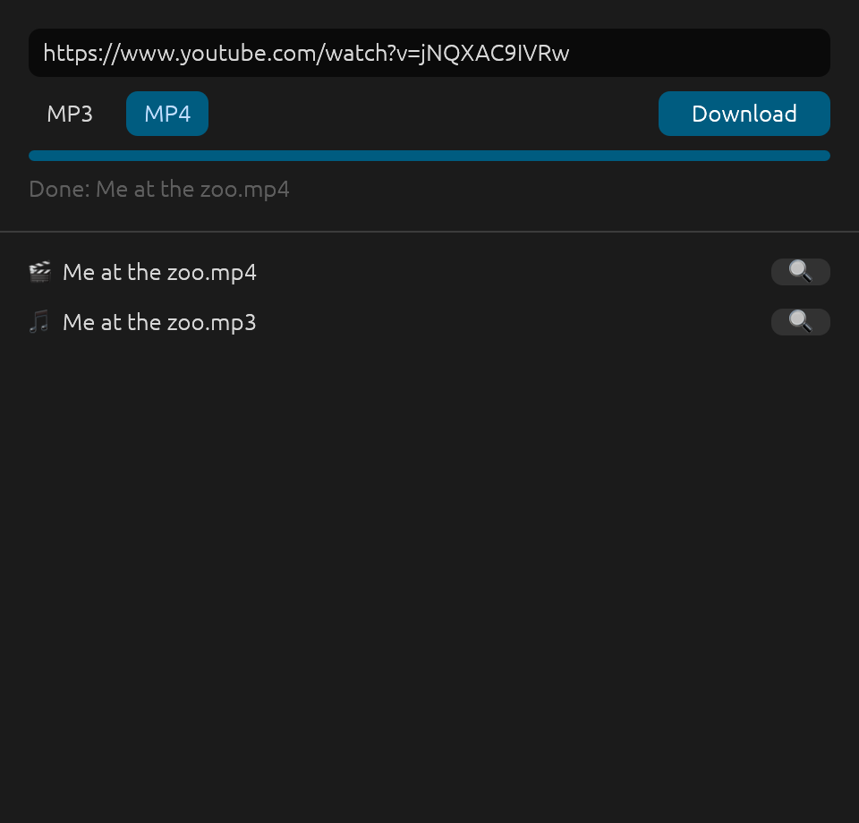

<p align="center"></p>

<h1 align="center">Download Anything (Almost)</h1>

<p align="center">
Paste a link, get an MP3 or MP4. No ads, no watermarks, no accounts.<br>
A tiny desktop app for <b>macOS</b>, <b>Windows</b> and <b>Linux</b>, powered by <a href="https://github.com/yt-dlp/yt-dlp">yt-dlp</a>.
</p>

<p align="center"></p>

**_If you have the link, you can probably download it._** YouTube, SoundCloud, Vimeo and [over a thousand other sites](https://github.com/yt-dlp/yt-dlp/blob/master/supportedsites.md).

## Features

- **MP3** (best quality) or **MP4** (H.264 + AAC, plays everywhere)
- Title, artist and cover art embedded in every file
- Whole playlists in one go
- Saves to your Downloads folder. Click a file to open it, or 🔍 to show it in its folder
- Picks up a link from your clipboard when it opens
- One-click **Update yt-dlp** when a site stops working

## Install

**1. Get yt-dlp and ffmpeg**

| OS | Run in a terminal |
|---|---|
| macOS | `brew install yt-dlp ffmpeg` (needs [Homebrew](https://brew.sh)) |
| Windows | `winget install yt-dlp.yt-dlp` (also installs ffmpeg and Deno) |
| Linux | `sudo apt install ffmpeg pipx` then `pipx install "yt-dlp[default]"`<br>YouTube also needs [Deno](https://deno.com): `curl -fsSL https://deno.land/install.sh \| sh` |

**2. Get the app** from the [latest release](https://github.com/Lexical-Luke/DownloadAnything_Almost/releases/latest)

| OS | File | First launch |
|---|---|---|
| macOS (Apple Silicon) | `DownloadAnything-macOS.zip` | Unzip, drag to Applications. If macOS blocks it: System Settings, Privacy & Security, **Open Anyway** |
| Windows | `DownloadAnything-Windows.exe` | If SmartScreen appears: **More info**, **Run anyway** |
| Linux | `DownloadAnything-Linux.tar.gz` | Extract and run `./download-anything` |

## When a site stops working

Sites change and break yt-dlp every few months. If a download fails, click **Update yt-dlp** in the app, then try again.

## Build from source

Needs [Rust](https://rustup.rs).

```bash
cargo run --release
```

On macOS, `scripts/bundle-macos.sh` builds a proper `Download Anything.app` in `target/`.

Every push is built and launch-tested on all three systems by [GitHub Actions](.github/workflows/build.yml). Pushing a `v*` tag publishes a release.

## History

This started in 2019 as a little AppleScript that ran youtube-dl in Terminal. It's now a native Rust app.

- [`v1.0`](https://github.com/Lexical-Luke/DownloadAnything_Almost/tree/v1.0): the original 2019 AppleScript (youtube-dl)
- [`v2.0`](https://github.com/Lexical-Luke/DownloadAnything_Almost/tree/v2.0): AppleScript updated for yt-dlp and Apple Silicon (2026)
- `v3.0`: rewritten in Rust for macOS, Windows and Linux
